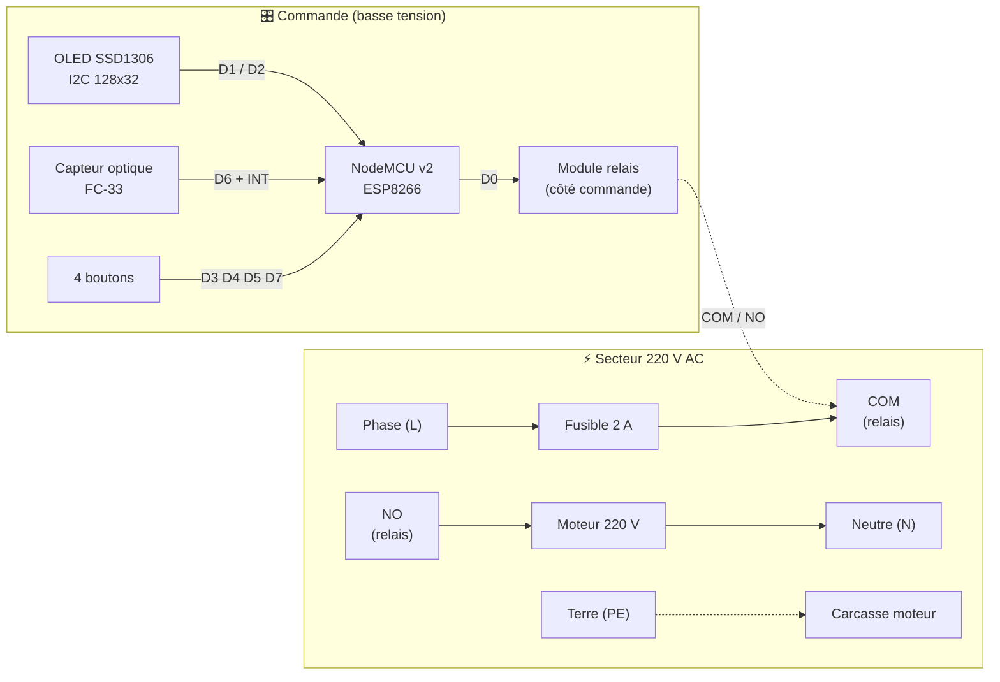

# Schéma de câblage — Compte-tours moteur 220 V

> ⚠️ **DANGER — 220 V secteur.** Ce montage comporte une partie en tension
> mortelle. Sectionnez toujours le courant avant toute intervention, utilisez un
> boîtier isolant fermé et ne laissez aucune partie métallique accessible.

---

## 1. Vue d'ensemble



---

## 2. Tableau de câblage complet

## 2. Vérification du pinout (image `docs/ESP8266-NodeMCU-kit-12-E-pinout-gpio-pin.webp`)

L'image de pinout de `docs/` correspond bien à votre carte : **NodeMCU v2 « Amica »**,
reconnaissable à sa puce **CP2102**. Voici la correspondance des étiquettes :

| Étiquette carte | GPIO réel | Nom interne | Utilisation dans ce projet |
|-----------------|-----------|-------------|----------------------------|
| `D0` | **GPIO16** | WAKE | ✅ Relais |
| `D1` | **GPIO5** | SCL | ✅ OLED SCL |
| `D2` | **GPIO4** | SDA | ✅ OLED SDA |
| `D3` | **GPIO0** | FLASH | ✅ Bouton `+` (⚠ pin de boot) |
| `D4` | **GPIO2** | TXD1 | ✅ Bouton `−` (⚠ pin de boot) |
| `D5` | **GPIO14** | SCLK | ✅ Bouton RAZ |
| `D6` | **GPIO12** | MISO | ✅ Capteur optique (interruption) |
| `D7` | **GPIO13** | MOSI | ✅ Bouton START |
| `D8` | **GPIO15** | CS | ⚠️ **Non utilisé** (doit rester BAS au boot) |
| `A0` | ADC0 | — | Non utilisé |
| `VIN` | — | — | ✅ **Entrée 5 V** (voir §2.3) |

**Conclusion : toutes les affectations du projet sont conformes à ce pinout.**
En particulier :

- `D1`/`D2` sont bien les broches **I²C matérielles** (SCL/SDA) ;
- `D6` = GPIO12 est **compatible avec les interruptions** (nécessaire pour le capteur) ;
- `D0` = GPIO16 est une **sortie simple, sans interruption** — parfait pour le relais ;
- `D8` = GPIO15 est **laissé libre**, car il doit rester à l'état BAS au démarrage.

### 2.1 Écran OLED (SSD1306, I2C)

| OLED | NodeMCU | GPIO | Remarque |
|------|---------|------|----------|
| `GND` | `GND` | — | Masse commune |
| `VCC` | **`VIN`** | — | **5 V** — régulateur interne ; ne démarre pas en 3,3 V |
| `SCL` | `D1` | GPIO5 | Horloge I²C |
| `SDA` | `D2` | GPIO4 | Données I²C |

> ⚠️ **Ce module OLED 0,91" nécessite 5 V sur `VCC`.** Alimenté en 3,3 V, son
> régulateur interne ne démarre pas : `SCL`/`SDA` restent à 0 V et aucun ACK I²C
> n'est reçu. En 5 V, les pull-ups internes ramènent `SCL`/`SDA` à 3,3 V, ce qui
> est compatible avec l'ESP8266.

### 2.2 Capteur optique FC-33 (à fourche)

| FC-33 | NodeMCU | GPIO | Remarque |
|-------|---------|------|----------|
| `GND` | `GND` | — | Masse commune |
| `VCC` | **`3V3`** | — | **Alimenter en 3,3 V** (voir ⚠ ci-dessous) |
| `OUT` | `D6` | GPIO12 | Entrée d'**interruption** |

> ⚠️ **Niveau logique.** L'ESP8266 tolère **3,3 V maximum** sur ses entrées.
> - Alimenter le FC-33 en **3,3 V** : la sortie `OUT` est alors en 3,3 V → **connexion directe OK**.
> - Si vous devez l'alimenter en **5 V**, intercalez impérativement un **diviseur de tension**
>   (R1 = 1 kΩ entre `OUT` et `D6`, R2 = 2 kΩ entre `D6` et `GND`) ou un **level shifter 3,3↔5 V**.

### 2.3 Module relais — côté commande

| Module relais | NodeMCU | GPIO | Remarque |
|---------------|---------|------|----------|
| `GND` | `GND` | — | Masse commune |
| `VCC` | **`VIN`** | — | **5 V** — `VIN` accepte bien 5 V (recommandé, 10 V max) |
| `IN` | `D0` | GPIO16 | Commande (voir ⚠ logique du relais) |

> ✅ **Vous avez raison : `VIN` accepte le 5 V.** C'est l'entrée du régulateur 3,3 V
> de la carte. La sérigraphie au dos de votre carte l'indique d'ailleurs :
> **« Vin +5V recommended +10V MAX »**.
>
> - **Carte alimentée par USB** : sur la plupart des NodeMCU, `VIN` délivre
>   ≈ **4,7–5 V** (5 V USB moins la chute de la diode de protection), ce qui suffit
>   à la bobine du relais — **vérifiez-le au multimètre** avant de brancher.
> - **Alimentation externe 5 V** : à brancher sur `VIN` (évitez alors d'alimenter
>   en même temps par USB).
> - ❌ Ne **jamais** alimenter la bobine 5 V depuis `3V3` : elle ne collerait pas
>   et vous surchargeriez le régulateur de la carte.

Ajouter un **condensateur électrolytique 100 µF** entre `VCC` et `GND` du module
relais, au plus près de celui-ci (absorbe le pic de courant à la commutation).

### 2.4 Module relais — côté puissance 220 V

Les **3 vis bleues** sont `COM`, `NO` et `NC`.

📷 **Relevé sur votre module** (photo `photos/photo_2026-10-11_09-36-33.jpg`) :
les trois bornes sont sérigraphiées en chinois. En regardant les vis avec le
relais derrière (comme sur la photo), de **gauche à droite** :

| Vis | Sérigraphie chinoise | Signification | À utiliser ? |
|-----|----------------------|---------------|--------------|
| 1 — **gauche** | **常开** *(cháng kāi)* | **NO** — normalement ouvert | ✅ **Départ moteur** |
| 2 — **milieu** | **公共端** *(gōng gòng duān)* | **COM** — commun | ✅ **Arrivée phase** |
| 3 — **droite** | **常闭** *(cháng bì)* | **NC** — normalement fermé | ❌ **Jamais** (danger) |

➡️ **Sur votre module : `COM` = vis du milieu, `NO` = vis de gauche, `NC` = vis de droite.**

| Borne | Nom complet | Rôle |
|-------|-------------|------|
| **COM** | Commun | ✅ Oui (arrivée phase) |
| **NO**  | *Normally Open* — 常开 | ✅ **Oui** (départ moteur) |
| **NC**  | *Normally Closed* — 常闭 | ❌ **Non** (danger : moteur alimenté au repos) |

| Connexion | De | Vers |
|-----------|----|------|
| Phase secteur | `L` du secteur | Fusible 2 A |
| Après fusible | Fusible | **`COM`** du relais |
| Sortie relais | **`NO`** du relais | Moteur (borne 1) |
| Retour moteur | Moteur (borne 2) | `N` du secteur |
| Terre | `PE` du secteur | Carcasse du moteur (directement) |
| Snubber RC | En parallèle sur les contacts `COM`–`NO` | 100 Ω / 1 W + 0,1 µF X2 275 VAC |

> 🔎 **Identifier COM / NO / NC au multimètre** (module NON alimenté, mode continuité) :
> 1. La paire qui **bipe** = `COM` ↔ `NC`.
> 2. La 3ᵉ vis isolée = `NO`.
> 3. Alimentez la bobine : la paire qui bipe devient `COM` ↔ `NO`.

### 2.5 Boutons poussoirs (× 4)

Chaque bouton relie la broche à la **masse** ; le microcontrôleur utilise sa
**résistance de tirage interne** (`INPUT_PULLUP`).

| Bouton | NodeMCU | GPIO | Fonction | Câblage |
|--------|---------|------|----------|---------|
| `+`     | `D3` | GPIO0  | Incrémente la consigne | broche ↔ bouton ↔ `GND` |
| `−`     | `D4` | GPIO2  | Décrémente la consigne | broche ↔ bouton ↔ `GND` |
| `RAZ`   | `D5` | GPIO14 | Remet le compteur à zéro et arrête | broche ↔ bouton ↔ `GND` |
| `START` | `D7` | GPIO13 | Démarre / arrête le moteur | broche ↔ bouton ↔ `GND` |

> ⚠️ `D3` (GPIO0) et `D4` (GPIO2) sont des **broches de démarrage** : elles doivent
> être à l'état HAUT au moment de la mise sous tension. Ne **pas** appuyer sur `+` ou `−`
> pendant la connexion USB ou le reset, sinon la carte entre en mode flash.

Schéma d'un bouton (répété 4 fois) :

```
   NodeMCU Dx ──────┬──────── [ bouton ] ──────── GND
                    │
             (pull-up interne activé par
              pinMode(..., INPUT_PULLUP))
```

---

## 3. Schéma ASCII récapitulatif

```
   +5V/VIN ──┬──────────────┬────────────────────┐
             │              │                    │
        [OLED VCC]    [Cond. 100µF]        [Relais VCC]
             │              │                    │
   +3V3 ─────┴───────[FC-33 VCC]               │
             │                                  │
  ┌──────────┴────┐   D1 (GPIO5)  ─ SCL ────[OLED]
  │               │   D2 (GPIO4)  ─ SDA ────[OLED]
  │   NodeMCU     │   D6 (GPIO12) ◄─ OUT ───[FC-33]
  │      v2       │
  │   (ESP8266)   │   D0 (GPIO16) ─ IN ─────[Relais]
  │               │
  │               │   D3 ◄── [+] ──── GND
  │               │   D4 ◄── [−] ──── GND
  │               │   D5 ◄── [RAZ] ── GND
  │               │   D7 ◄── [START]─ GND
  └───────┬───────┘
          │
          └── GND ──── masse commune (OLED, capteur, relais, boutons)
```

---

## 4. Alimentation

| Rail | Source | Consommateurs |
|------|--------|---------------|
| **5 V** (`VIN`) | USB ou alim. externe 5 V / 2 A | OLED (~20 mA), bobine du relais (~90 mA), régulateur de la carte |
| **3,3 V** (`3V3`) | Régulateur AMS1117 de la NodeMCU | ESP8266 (+ pointes ~300 mA), capteur (~15 mA) |

> Une alimentation **5 V / 2 A** dédiée est recommandée si vous n'utilisez pas l'USB.

### Où récupérer le 3,3 V ? (3 broches disponibles)

L'image de pinout montre **3 broches 3,3 V**, toutes reliées au **même rail**
(sortie du régulateur AMS1117). N'importe laquelle convient :

| Position sur la carte | Repère |
|-----------------------|--------|
| Header **droit**, entre `D4` et `GND` | `3.3V` |
| Header **droit**, tout en bas (sous `TX` / `GND`) | `3.3V` |
| Header **gauche**, entre `GND` et `EN` | `3.3V` |

Répartition conseillée (câbles courts) :

- **OLED `VCC`** → **`VIN` (5 V)**, tout en bas à gauche du header gauche.
- **Capteur FC-33 `VCC`** → `3.3V` du bas à droite du header droit (ou du header gauche).
- **`GND`** → n'importe quelle broche `GND` (toutes communes).

> ⚠️ Ne **jamais** alimenter la bobine du relais en 3,3 V (utiliser `VIN`, 5 V), et ne pas
> injecter une alimentation 3,3 V externe sur ces broches quand la carte est déjà alimentée.

### Répartition des deux headers

| Header | Broches utilisées dans ce projet |
|--------|----------------------------------|
| **Droit** | `D0` (relais `IN`), `D1`/`D2` (OLED), `D3`/`D4`/`D5`/`D7` (boutons), `D6` (capteur), `3.3V` + `GND` (capteur), `GND` (OLED) |
| **Gauche** | **`VIN`** (5 V pour l'OLED **et** le relais), éventuellement un `GND` |

➡️ **Tous les signaux sont bien sur le header de droite.** Le header de gauche ne sert
que pour le **5 V** (`VIN`, broche tout en bas à gauche), partagé par l'OLED et le relais.

Si vous préférez **ne pas utiliser le header de gauche**, alimentez le relais avec une
**alimentation 5 V externe** et reliez sa masse (`GND`) à un `GND` du header de droite
(les masses doivent impérativement être communes).

---

## 5. Points de vigilance

1. **Logique du relais.** Vérifiez si votre module est **actif bas** ou **actif haut**
   et réglez `RELAY_ACTIVE_LOW` en conséquence dans `include/config.h`.
   Testez **sans le moteur** (avec une lampe) pour vérifier qu'il ne colle pas au démarrage.
2. **GPIO16** est *high-Z* à la mise sous tension : le relais doit rester au repos.
   Si le moteur démarre brièvement au boot, ajoutez le **transistor inverseur** (voir README).
3. **Snubber RC obligatoire** sur les contacts : le moteur est une charge inductive
   qui génère des arcs et soude les contacts à terme.
4. **Fusible** sur la phase, **boîtier isolant**, **terre** connectée à la carcasse moteur.
5. **N'utilisez jamais `NC`** pour un moteur : il serait alimenté au repos.
6. **Le disque à encoches** doit passer dans la fourche du capteur, sur l'arbre du moteur.
   Un disque plein à 1 encoche produit **2 impulsions/tour** (entrée + sortie de l'encoche)
   → bien régler `PULSES_PER_TURN = 2` dans `config.h`.
7. **Alimentation 5 V : `VIN`, pas `3V3`.** L'OLED **et** la bobine du relais se
   branchent sur `VIN` (5 V recommandé, 10 V max). Quand la carte est alimentée par
   USB, on y retrouve ≈ 4,7–5 V. Le capteur FC-33 reste, lui, sur `3V3`.
